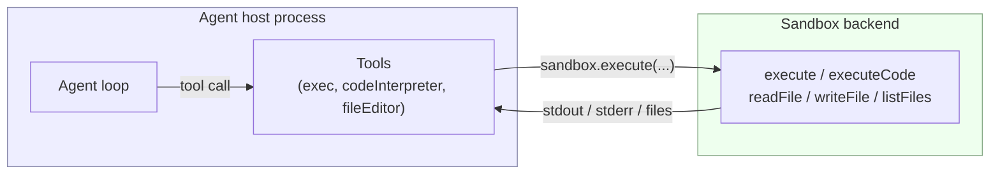
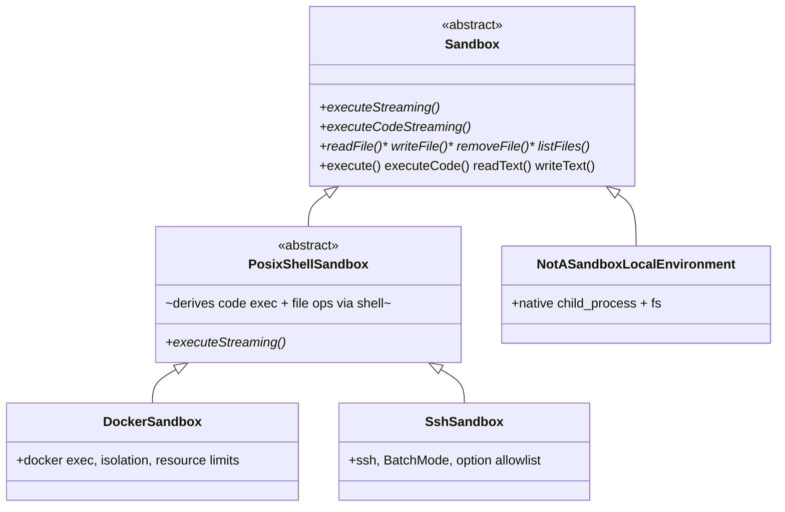

# Sandbox

**Status**: Accepted

**Date**: 2026-06-03

**Issue**: [tools#335: Tools break in AgentCore Runtime](https://github.com/strands-agents/tools/issues/335)

**Related**:
- [sdk-python#2198: Sandbox abstraction](https://github.com/strands-agents/sdk-python/issues/2198)
- [sdk-python#2476: Sandbox tracking](https://github.com/strands-agents/sdk-python/issues/2476)
- [sdk-python#1540: Code-based tool execution](https://github.com/strands-agents/sdk-python/issues/1540)

**Scope**: Cross-SDK design. TypeScript implementation landed first across [sdk-typescript#1090](https://github.com/strands-agents/sdk-typescript/pull/1090) (base interface) and [sdk-typescript#1011](https://github.com/strands-agents/sdk-typescript/pull/1011) (Docker/SSH backends, vended tools, plugin and agent integration). Python implementation mirrors the same interface.

## Context

Tools that run code, execute commands, or touch a filesystem hardcode *where* those operations happen. `python_repl` forks a PTY on the host. `shell` spawns subprocesses through its own executor. `code_interpreter` calls the AgentCore API. Each tool reimplements process management, output capture, and file access against one fixed environment.

This coupling creates three concrete problems.

**Tools break when the environment changes.** Deploy an agent to AgentCore Runtime and tools that assume local filesystem access fail immediately. [tools#335](https://github.com/strands-agents/tools/issues/335) documents this: `python_repl` writes to `Path.cwd()`, `journal` writes to the home directory, `workflow` writes to `~/.strands/workflows`. The only writable path in Runtime is `/tmp`. Today the workaround is a per-tool environment variable (`PYTHON_REPL_PERSISTENCE_DIR`, `STRANDS_WORKFLOW_DIR`, …) — every tool needs its own. There is no single switch to say "run the same tools, but inside a Docker container" or "on a remote host."

**Tools cannot share an execution environment.** When an agent uses `shell` to write a file and then a code tool to read it, the two tools run in separate contexts — no shared working directory, no shared filesystem. A comment on [tools#335](https://github.com/strands-agents/tools/issues/335) asks for a `STRANDS_WORKING_DIR` so tools can share a directory. The real need is deeper than an env var: tools need a shared *execution environment*.

**There is no isolation primitive.** Running model-generated commands and code on the host is fine for trusted, local development but unacceptable for untrusted workloads. There is no first-class way to contain what a tool can do (filesystem reach, network, capabilities, resource limits) without rewriting the tool.

The audience is anyone running an agent that executes code or commands: developers iterating locally, teams deploying to the cloud, and anyone running untrusted or model-generated code who needs isolation.

## Decision

We introduce **`Sandbox`**, an SDK-level abstraction that decouples a tool's *logic* from *where its operations run*.

The key mental model: **tool logic still runs in the agent's host process** — argument parsing, validation, output formatting, error handling. Only the underlying *operations* (spawning a shell, executing code, reading and writing files) route through the configured `Sandbox`. The sandbox is the "where," completely independent of the SDK's tool executor (which controls scheduling — concurrent vs. sequential).



When a user explicitly provides a `Sandbox` (a Docker container, a remote host over SSH, etc.), the agent automatically gains a set of vended tools that route their operations through that sandbox. The same agent then executes locally during development or in an isolated/remote environment with a single config change. When no sandbox is configured, the agent behaves exactly as it does today — operating on the host with no auto-registered tools.

### The interface

The `Sandbox` base class defines six abstract operations and a set of non-streaming convenience wrappers built on top of them. **Streaming is the primitive**: the two execution methods yield output chunks as they arrive and finish with a final result. This lets UIs render live output and lets callers handle long-running commands without buffering everything in memory. The non-streaming `execute`/`executeCode` wrappers simply consume the stream and return the final result.

```typescript
abstract class Sandbox {
  // --- Abstract primitives ---

  // Streaming command execution: yields StreamChunks, ends with an ExecutionResult.
  abstract executeStreaming(
    command: string,
    options?: ExecuteOptions
  ): AsyncIterable<StreamChunk | ExecutionResult>

  // Streaming code execution via a language interpreter (e.g. "python3", "node").
  abstract executeCodeStreaming(
    code: string,
    language: string,
    options?: ExecuteOptions
  ): AsyncIterable<StreamChunk | ExecutionResult>

  // Binary-first file I/O.
  abstract readFile(path: string): Promise<Uint8Array>
  abstract writeFile(path: string, content: Uint8Array): Promise<void>
  abstract removeFile(path: string): Promise<void>
  abstract listFiles(path: string): Promise<FileInfo[]>

  // --- Convenience wrappers (provided by the base class) ---

  execute(command: string, options?: ExecuteOptions): Promise<ExecutionResult>
  executeCode(code: string, language: string, options?: ExecuteOptions): Promise<ExecutionResult>
  readText(path: string): Promise<string>   // UTF-8 decode over readFile
  writeText(path: string, content: string): Promise<void>  // UTF-8 encode over writeFile
}
```

Supporting types:

```typescript
interface ExecuteOptions {
  timeout?: number      // seconds; undefined = no timeout
  cwd?: string          // working directory; undefined = sandbox default
  signal?: AbortSignal  // cancel execution (kills the process)
}

interface StreamChunk {
  readonly type: 'streamChunk'
  readonly data: string
  readonly streamType: 'stdout' | 'stderr'
}

interface ExecutionResult {
  readonly type: 'executionResult'
  readonly exitCode: number
  readonly stdout: string
  readonly stderr: string
  readonly outputFiles: OutputFile[]  // binary artifacts (charts, PDFs, …); usually [] for shell backends
}

interface FileInfo {
  readonly name: string
  readonly isDir?: boolean   // undefined when the backend can't determine it
  readonly size?: number
}
```

Three design choices are worth calling out:

- **File I/O is binary-first** (`Uint8Array`), with `readText`/`writeText` as UTF-8 conveniences. This makes binary files (images, compiled artifacts, archives) first-class instead of corrupting them through string round-trips.
- **`outputFiles`** lets code execution return generated artifacts. Shell-based backends typically return an empty array; Jupyter- or API-backed backends can populate it (a chart from `matplotlib`, a generated PDF).
- **`removeFile`** rounds out the filesystem operations so tools never need to fall back to `execute("rm ...")` for a common case.

### Shell-based defaults: `PosixShellSandbox`

Most real backends only give you shell access. `PosixShellSandbox` is an abstract subclass that implements *everything* in terms of a single primitive — subclasses implement only `executeStreaming`, and the base derives code execution and all file operations from shell commands:

- `executeCodeStreaming` pipes a base64-encoded heredoc into the interpreter (`base64 -d << 'EOF' | python3`), which is binary-safe and immune to quoting issues in the source.
- `readFile`/`writeFile` use `base64`-encoded transfer; `listFiles` parses `ls`; `removeFile` runs `rm`.
- A `shellQuote()` helper single-quotes and escapes arguments to prevent shell injection, and a randomized `STRANDS_EOF_<uuid>` delimiter prevents content from terminating the heredoc early.

Subclasses may override any derived method with a native implementation when the backend offers something better (e.g. binary-safe file transfer via `docker cp`, or a cloud filesystem API).

This is the layering that matters: **one abstract method gets you a fully functional sandbox**, and native overrides are an optimization, not a requirement.



### Backends

| Backend | Where it runs | Isolation | Use case |
|---------|---------------|-----------|----------|
| `NotASandboxLocalEnvironment` | Host process | **None** | Development, trusted agents. The implicit default. |
| `DockerSandbox` | Docker container | Process + filesystem + (optional) network | Production, untrusted code |
| `SshSandbox` | Remote host via SSH | Remote machine boundary | Dev servers, dedicated runners |

The default is deliberately named **`NotASandboxLocalEnvironment`**. It implements the `Sandbox` interface (so tools have a uniform path) but it runs with the full permissions of the host process. The name is a warning, not a description: it is *not* a security boundary. It extends `Sandbox` directly (not `PosixShellSandbox`) and uses native Node `child_process` + `fs/promises` for correctness and speed.

`DockerSandbox` and `SshSandbox` both extend `PosixShellSandbox`. They are secure-by-default:

- **`DockerSandbox`** creates the container on `start()` and destroys it on `stop()`; every operation routes through `docker exec`. Defaults: non-root user (`1000:1000`), `--cap-drop ALL`, `--security-opt no-new-privileges`, working dir `/tmp` (world-writable under the non-root user). Optional `memory`, `cpus`, `pidsLimit` (fork-bomb protection), and `network: 'none'`. Bind mounts that expose sensitive host paths (`/`, `/etc`, `/proc`, `/sys`, `/var/run`, …) throw at construction time unless `allowDangerousMounts` is set. `writeFile` is overridden to stream bytes via `docker exec -i … cat >` for binary safety.
- **`SshSandbox`** is stateless — each call spawns a fresh `ssh` process. All sessions use `BatchMode=yes` (no interactive prompts; key-based auth only) and `StrictHostKeyChecking=accept-new` by default (trust on first use, reject on key change). Extra SSH options are validated against an AppSec-reviewed allowlist unless `allowUnsafeSshOptions` is set.

The interface is open for extension: third-party providers (E2B, Daytona, a cloud code-interpreter, an in-process virtual shell) implement `executeStreaming` on top of `PosixShellSandbox` and plug into the same ecosystem.

### Agent integration

The `Agent` gains an optional `sandbox` field:

```typescript
sandbox?: Sandbox | false
```

The behavior is:

- **Omitted** → the agent defaults to `NotASandboxLocalEnvironment` (Node only). No sandbox tools are auto-registered. Existing behavior is preserved.
- **A `Sandbox` instance** → the agent calls `sandbox.start()` during initialization and **auto-registers the sandbox default tools** (`exec`, `codeInterpreter`, `fileEditor`). These operate through the sandbox.
- **`false`** → sandbox is explicitly disabled and no tools are auto-registered.

Tools reach the sandbox through the tool/agent context (`context.agent.sandbox`), so a tool never manages its own subprocess or filesystem logic — it delegates.

### Vended tools

When a sandbox is configured, three tools are auto-registered:

- **`exec`** — run a shell command. Fresh process per call; use the `workdir` argument instead of `cd`.
- **`codeInterpreter`** — run source code in a given language via the interpreter (`python3 -c <code>`, etc.). For computation, data processing, and file generation.
- **`fileEditor`** — view (with line ranges), create, `str_replace`, `insert`, `undo`, plus `grep` (search contents) and `glob` (find by name). Paths absolute or relative to the working directory.

### Plugin integrations

The sandbox composes with existing plugins:

- **`SandboxStorage`** — a storage backend for `ContextOffloader` ([design 0009](./0009-context-offloader.md)). Offloaded tool results are written to the *sandbox* filesystem instead of the host, so large content stays inside the container.
- **Skills from the sandbox** — `AgentSkills` can load `SKILL.md` files from the sandbox filesystem, so an agent can pick up skills that live in its execution environment.

## Developer Experience

**Local development — nothing changes:**

```typescript
import { Agent } from '@strands-agents/sdk'

// No sandbox: runs on the host, exactly as before.
const agent = new Agent({ systemPrompt: 'You are a helpful assistant.' })
```

**Add isolation with one line:**

```typescript
import { Agent } from '@strands-agents/sdk'
import { DockerSandbox } from '@strands-agents/sdk/sandbox'

const sandbox = new DockerSandbox({ image: 'python:3.12-slim' })
try {
  const agent = new Agent({
    sandbox, // exec, codeInterpreter, fileEditor are auto-registered
    systemPrompt: 'You can run shell commands, execute code, and manage files.',
  })
  const result = await agent.invoke(
    'Create hello.py with a hello-world script, run it, and show the output.'
  )
  console.log(result)
} finally {
  await sandbox.stop()
}
```

**Swap to a remote host — same agent, different backend:**

```typescript
import { SshSandbox } from '@strands-agents/sdk/sandbox'

const sandbox = new SshSandbox({
  host: 'user@dev-server.example.com',
  workingDir: '/home/user/workspace',
  identityFile: '~/.ssh/id_ed25519',
})
```

**Lock down an untrusted workload:**

```typescript
const sandbox = new DockerSandbox({
  image: 'python:3.12-slim',
  memory: '256m',
  cpus: 0.5,
  pidsLimit: 50,
  network: 'none',   // no network access
  user: '1000',      // non-root (default)
})
```

**Use the sandbox directly (outside the agent loop):**

```typescript
await sandbox.writeText('data.txt', 'hello')
const text = await sandbox.readText('data.txt')

const result = await sandbox.execute('python3 --version')
console.log(result.exitCode, result.stdout)

// Stream long-running output:
for await (const chunk of sandbox.executeStreaming('pip install numpy')) {
  if (chunk.type === 'streamChunk') process.stdout.write(chunk.data)
  else console.log(`exit ${chunk.exitCode}`)
}
```

**Share one sandbox across agents** (collaboration through a shared filesystem) — pass the same instance to multiple agents:

```typescript
const shared = new DockerSandbox({ image: 'python:3.12-slim' })
const writer = new Agent({ sandbox: shared, systemPrompt: 'You write files.' })
const reader = new Agent({ sandbox: shared, systemPrompt: 'You read files.' })
```

### Edge cases and errors

- **State does not persist between calls.** `cd` and `export` in one `exec` call do not carry to the next — each call is a fresh process. Tools use the `cwd`/`workdir` option instead. `DockerSandbox` persists *filesystem* changes (same container) but not shell state. This avoids races when tools run concurrently.
- **`execute()` throws if the backend never yields a result** (a defensive guard on the streaming contract).
- **`DockerSandbox` throws at construction** for dangerous bind mounts, and at `start()` if Docker is not installed.
- **`SshSandbox` rejects** unknown SSH options and (by default) changed host keys.
- **`sandbox` getter throws** if accessed when no sandbox is available, with a message pointing to the config field.

## Alternatives Considered

**Single `execute()` interface (the original proposal).** The first draft recommended one abstract method — `execute()` — with all file and code operations derived from it, following LangChain DeepAgents. We kept that *spirit* in `PosixShellSandbox` (one method, `executeStreaming`, derives the rest) but made the **base `Sandbox`** richer: streaming primitives, binary file I/O, and `removeFile`/`listFiles` as first-class abstract methods. Reasons: (1) streaming is needed for live output and long-running commands and cannot be bolted onto a buffered `execute()` cleanly; (2) binary-safe file I/O matters and degrades badly when forced through string-only shell `cat`; (3) backends with native file APIs (cloud interpreters) deserve to express them directly. The single-method ergonomics are preserved exactly where they pay off — writing a new shell-based backend.

**Sandbox as a per-tool option.** Inject a sandbox into each tool's constructor instead of the agent. Rejected: the shared-environment property (tools operating on the same filesystem) requires an agent-level instance, and per-tool injection gives no guarantee that tools share one sandbox.

**Extending the tool executor.** Add sandbox behavior to the executor that schedules tools. Rejected: scheduling (concurrent vs. sequential) and environment (where code runs) are orthogonal. A tool should be able to run in a Docker sandbox *and* be scheduled concurrently; these compose independently.

**CodeAct plugin and a `programmatic_tool_caller` tool.** Earlier drafts bundled code-orchestration paradigms (a CodeAct hook that makes the model respond in code, and a tool that lets the model write code to call other tools) and a host↔sandbox **tool proxy** to run model-generated orchestration code fully inside the sandbox. We **descoped these from the accepted design.** The `Sandbox` primitive is the foundation they would build on, and shipping it cleanly first is the priority. Code-orchestration paradigms and the tool proxy can be proposed as follow-up designs once `Sandbox` is established. This keeps the accepted scope to one well-defined primitive.

**Naming.** We considered `Runtime` (collides with "Python runtime", "AgentCore Runtime"), `Environment` (overloaded), `ExecutionBackend` (verbose), and `Workspace`/`Shell` (too narrow). We chose **`Sandbox`** — it aligns with the E2B/Daytona/LangChain ecosystem and implies containment. The one risk (it implies isolation the local default does not provide) is handled head-on by naming that default `NotASandboxLocalEnvironment`.

## Consequences

**Easier:**

- One config change moves an agent between local, Docker, and remote execution — no tool rewrites.
- Tools share a filesystem and working directory through a single sandbox instance.
- Untrusted and model-generated code gets real isolation (containers, resource limits, network controls) without touching tool code.
- New tools delegate execution to the sandbox instead of reimplementing process and file handling.
- Plugins (`ContextOffloader`, `AgentSkills`) extend naturally to the sandbox filesystem.
- The per-tool environment-variable workarounds from [tools#335](https://github.com/strands-agents/tools/issues/335) collapse into sandbox configuration.

**Harder / costs:**

- **A new core concept** to learn and document, and a new agent field.
- **No state across calls** by default. Tools relying on persistent `cd`/`export` must use `cwd`/`workdir` or manage state themselves.
- **Concurrency is backend-defined.** The interface makes no concurrency guarantee; backends document their behavior (`DockerSandbox`/`SshSandbox` are naturally per-process; a future persistent-shell local mode would need care).
- **Interactive PTY** does not map cleanly onto remote backends and is intentionally not part of the abstract interface; it stays a local concern.
- **Backend prerequisites** (a Docker daemon, SSH reachability and keys) are operational requirements the user must satisfy.

**Migration / backwards compatibility.** Fully backwards compatible. An agent with no `sandbox` keeps today's behavior and registers no new tools. Adopting a sandbox is strictly opt-in.

## Willingness to Implement

Yes — already in progress. The TypeScript implementation has landed ([sdk-typescript#1090](https://github.com/strands-agents/sdk-typescript/pull/1090), [sdk-typescript#1011](https://github.com/strands-agents/sdk-typescript/pull/1011)) with `Sandbox`, `PosixShellSandbox`, `DockerSandbox`, `SshSandbox`, the `exec`/`codeInterpreter`/`fileEditor` tools, agent integration, and the `ContextOffloader`/`AgentSkills` integrations. The Python SDK mirrors the same interface and backends.

## References

- [Issue tools#335: Tools break in AgentCore Runtime](https://github.com/strands-agents/tools/issues/335)
- [Issue sdk-python#2198: Sandbox abstraction](https://github.com/strands-agents/sdk-python/issues/2198)
- [PR sdk-typescript#1090: base Sandbox interface](https://github.com/strands-agents/sdk-typescript/pull/1090)
- [PR sdk-typescript#1011: Docker/SSH backends, tools, plugins, agent integration](https://github.com/strands-agents/sdk-typescript/pull/1011)
- [Design 0009: Context Offloader](./0009-context-offloader.md)
- [E2B: Code Interpreter SDK](https://e2b.dev)
- [Daytona: AI Sandbox SDK](https://www.daytona.io)
- [LangChain DeepAgents: Sandbox backends](https://docs.langchain.com/oss/python/deepagents/sandboxes)
- [Anthropic: Sandbox Runtime](https://github.com/anthropic-experimental/sandbox-runtime)
